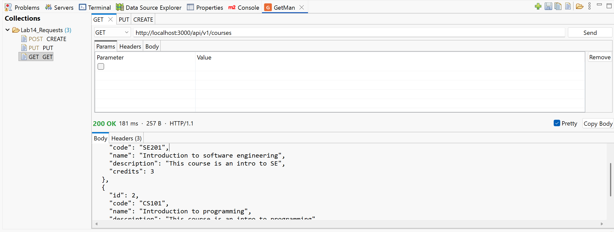
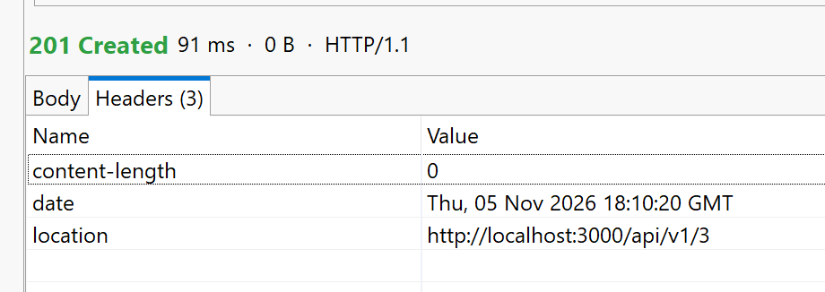
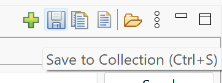
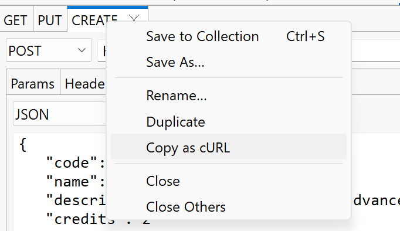

# GetMan

[](https://github.com/skanderturki/getman/releases/latest)
[](LICENSE)

A free, lightweight REST/HTTP client built into the Eclipse IDE — no account, no cloud sync, no extra app.

## Install

1. In Eclipse, open **Help › Install New Software…**, click **Add…** and enter the update site:

   ```
   https://skanderturki.github.io/getman-update-site/
   ```

2. Tick **GetMan REST Client** and finish the wizard, then restart Eclipse.
3. Open it with **Window › Show View › Other… › GetMan › GetMan**.

Offline: download `getman-*-update-site.zip` from the [latest release](https://github.com/skanderturki/getman/releases/latest)
and use **Add… › Archive…** instead.

Requires Eclipse 2024-03 (4.31) or newer and Java 17+.

## Screenshots

**Collections and a request with its response**



**Every response header, one click away**



**Save to a collection with Ctrl+S or the toolbar**



**Copy any request as cURL**



## Features (0.2)

- **Request tabs** – method, URL, query params, headers and body (JSON, text, XML, form). Double-click a tab to
  rename it; right-click for Duplicate, Copy as cURL, Close, Close Others.
- **Auth helper** – an **Auth** section per request: *Bearer Token* or *Basic Auth* (username/password), sent as
  the `Authorization` header. A header you add yourself in **Headers** takes precedence. Secrets are masked
  (tick *Show* to reveal) and left out of collection exports unless you choose to include them.
- **Collections** – a tree on the left of the view. `Ctrl+S` in a request tab saves it to a collection (you pick
  the collection and name the first time; afterwards `Ctrl+S` just updates it). Tabs with unsaved changes show a
  `*`. Double-click a saved request to open it; right-click for Rename (F2), Duplicate, Move Up/Down, Delete
  (Del), Export… and Import… (shareable `.getman.json` files).
- **Saved automatically** – collections and open tabs are stored as JSON in the plugin's state folder
  (`<workspace>/.metadata/.plugins/com.getman.ui/state.json`) and restored when Eclipse restarts.
- **Full response details** – status (colour-coded), time, size, HTTP version, all response headers, and the
  body, with JSON pretty-printing. Copy the body or headers to the clipboard.
- **Keyboard first** – `Ctrl+Enter` (`Cmd+Enter` on macOS) sends from anywhere in the tab; `Enter` in the URL
  field sends too. Click **Cancel** to abort a slow request.
- **Copy as cURL** – share or reproduce a request in a terminal.
- **No dependencies** – uses the JDK's `java.net.http` client; runs on Java 17+.

## Roadmap

1. Folders inside collections, drag and drop
2. Store auth secrets in Eclipse secure storage instead of the workspace state file
3. Paste a cURL command to create a request
4. Request history
5. Environments with `{{variables}}`
6. Preferences page (timeouts, redirects, trust self-signed certificates for local development)
7. Postman v2.1 collection import

## Project layout

| Path | What it is |
|---|---|
| `bundles/com.getman.core` | UI-free logic: model, HTTP client, JSON, persistence, cURL export |
| `bundles/com.getman.ui` | The Eclipse view (SWT/JFace) |
| `tests/com.getman.core.tests` | JUnit 5 tests for core (test fragment) |
| `features/com.getman.feature` | Installable feature grouping the two bundles |
| `releng/com.getman.site` | Builds the p2 update site |

## Building

Requires JDK 17+ and Maven 3.9+.

```sh
mvn clean verify
```

This compiles everything, runs the tests, and produces the update site in
`releng/com.getman.site/target/repository/` (also zipped as `com.getman.site-*.zip`).

To publish a release, copy the contents of `target/repository/` into the update-site repository
([getman-update-site](https://github.com/skanderturki/getman-update-site)) and push it.

## Developing in Eclipse

1. Use **Eclipse IDE for RCP and RAP Developers** (it includes PDE).
2. **File › Import › General › Existing Projects into Workspace**, select this folder, tick *Search for nested
   projects*, and import all five projects.
3. Run it: right-click `com.getman.ui` › **Run As › Eclipse Application**. A second Eclipse starts with the
   plugin installed; open the GetMan view there.

Alternatively, import as **Existing Maven Projects** if you have m2e with the Tycho connector.

## License

[Eclipse Public License 2.0](LICENSE)
