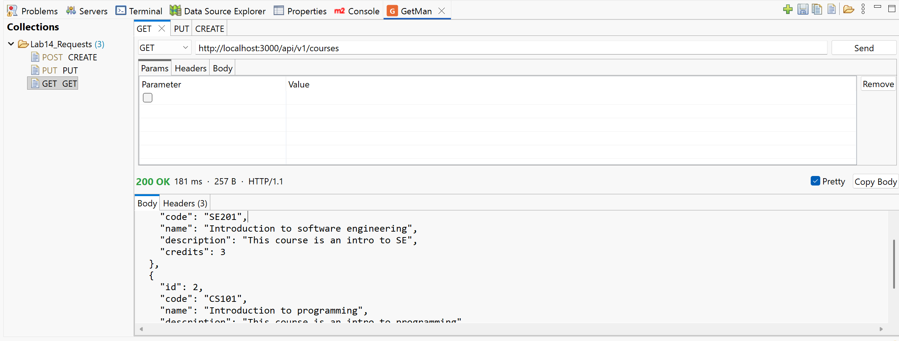

# GetMan User Guide

GetMan is a free, open-source REST/HTTP client that lives inside the Eclipse IDE. You can build and send requests,
see the full response, organise requests in collections, and switch between environments, all without leaving
Eclipse. There's no account, no cloud sync and no telemetry.

## Contents

1. [Getting started](getting-started.md): install GetMan, open the view and send your first request
2. [Requests and responses](requests.md): method, URL, params, headers, bodies, file uploads and the response panel
3. [Authorization](auth.md): Bearer tokens and Basic auth
4. [Collections and folders](collections.md): save, organise, move, export and share requests
5. [Environments and variables](environments.md): `{{variables}}`, environments and collection variables
6. [Import and export](import-export.md): cURL, Postman collections and environments, GetMan files
7. [History](history.md): every request you send, ready to open again
8. [AI assistants (MCP)](ai-assistants.md): let Claude Code, GitHub Copilot, Codex and other assistants create and send requests
9. [Preferences](preferences.md): timeouts, redirects, HTTPS certificates and history size
10. [Troubleshooting and FAQ](troubleshooting.md): common problems, and where your data is stored

## Quick reference

| Action | How |
|---|---|
| Open GetMan | **Window › Show View › Other… › GetMan › GetMan** |
| New request | **+** in the view toolbar |
| Send / cancel | **Send** button, `Ctrl+Enter` (`Cmd+Enter` on macOS), or `Enter` in the URL field |
| Save to a collection | `Ctrl+S`; Save All: `Ctrl+Shift+S` |
| Import a cURL command | Paste it into the URL field, or **Import cURL Command…** in the toolbar |
| Rename a tab | Double-click it |
| Pick an environment | The dropdown at the left of the view toolbar |
| Preferences | **Window › Preferences › GetMan** |

GetMan is maintained by Jahiz Digital Solutions (Jahiz.tn) and released under the
[Eclipse Public License 2.0](https://www.eclipse.org/legal/epl-2.0/). Source code, issues and ideas:
[github.com/skanderturki/getman](https://github.com/skanderturki/getman).
